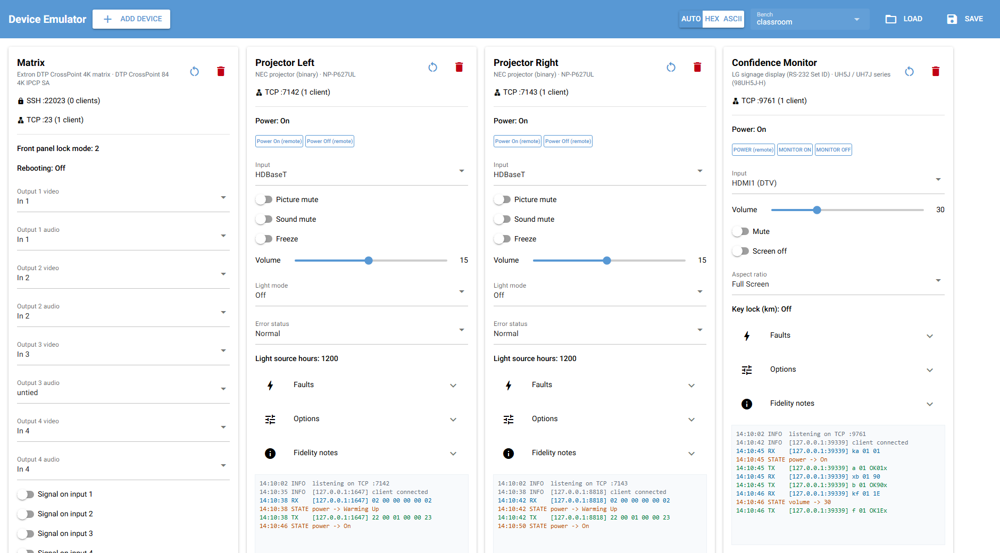
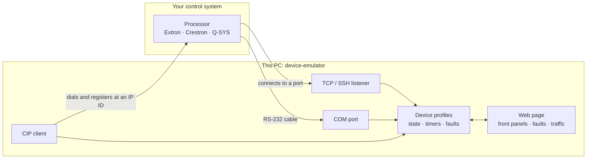

<div align="center">

# device-emulator

**Test AV control code against displays, projectors, matrices, DSPs and Crestron gear that aren't on your desk.**

Your Extron, Crestron or Q-SYS program connects to a real TCP port, SSH session or COM port,<br>
and gets back exactly what the real device would send: the same bytes, the same refusals, the same timing.


-lightgrey)



<sub>The <code>classroom</code> bench after a control program powered the projectors on, tied the matrix and switched the LG display: every card shows the device's live state, and its log shows each frame received, each state change and each reply.</sub>

</div>

---

## Why

Control code is usually finished before the room is: displays are still in boxes, the projector is on a lift, the DSP
is at the integrator's shop. So the code is written against a protocol PDF and first meets the hardware on site, where
every wrong reply shape, missed warm-up and unhandled refusal costs a site visit.

**device-emulator puts the devices on your network now.** Each emulated device listens where the real one listens,
answers only in the shapes the real one sends, refuses what the real one refuses (commands while it's off, a
projector power-on during cool-down), pushes status only if the real one does, and keeps its own clock for warm-up,
boot and reconnect times. A web page shows every device's state and traffic, lets you work its front panel like
someone in the room, and lets you break it on purpose.

It isn't a mock written to make tests pass. Every profile was built from the manufacturer's protocol document and then
run against the real control module for that device, over real sockets. Where the manual and the module disagree, the
emulator says so. What's confirmed, what it was confirmed against, and what's a best guess is written on each
device's card under **Fidelity notes**.

## Highlights

|                                    |                                                                                                                                                                                 |
| ---------------------------------- | ------------------------------------------------------------------------------------------------------------------------------------------------------------------------------- |
| 🔌 **Real transports**              | TCP, SSH (Extron SIS-over-SSH, Tesira), and real COM ports through a USB-serial adapter. A device can listen on LAN and RS-232 at once, like the real one.                      |
| 📡 **Crestron devices that dial in** | Panels, DM NVX endpoints and an IV-SAM-VX2 register with your processor over CIP at their IP IDs, so a SIMPL program sees them come online, gets their presses and sends feedback. |
| 🎚️ **Biamp Tesira designs**         | Describe the blocks and instance tags of your design in JSON; a mistyped tag in your code gets the real "address not found" error.                                              |
| ⏱️ **Timing is state**              | Warm-up, cool-down, boot after a power cycle, a Samsung's reconnect after LAN power-on, an Extron matrix reboot: all on the device's own clock.                               |
| 💥 **Faults on demand**             | Offline, silent, corrupt replies, reply delay, dropped connections, power cycle: one switch each, so you can see what your code does when the room misbehaves.                 |
| 🗂️ **Benches**                      | A room's devices saved as one JSON file and loaded with one click or `--bench`, so a project's test rig comes back exactly as it was.                                           |
| 🔍 **Readable traffic**             | Every received frame, reply, unsolicited push and state change, timestamped, in hex or ASCII per protocol.                                                                     |

## Quick start

You need **Windows** and a **64-bit Python 3.10–3.13**. NiceGUI's dependencies don't install on a 32-bit Python, and
plain `py` may start one, so name the version with the launcher (`run.py` stops with a message on a 32-bit Python).

```powershell
git clone https://github.com/JaimeMaertz/device-emulator
cd device-emulator
py -3.12 -m pip install -r requirements.txt
py -3.12 run.py --bench classroom
```

The page opens at <http://localhost:8080> with a matrix, two projectors, a display and a Blu-ray player, each listening
on its real control port. Point your control program at this PC's address and run it.

```text
py -3.12 run.py                          an empty bench: add devices on the page
py -3.12 run.py --bench conference-room  a bench from benches/, by name, or a path to a .json file
py -3.12 run.py --port 8081              another web port (one emulator per port)
py -3.12 run.py --no-browser             don't open a browser tab
```

> [!IMPORTANT]
> **Allow Python through the Windows firewall on the network your processor is on.** Windows asks the first time and
> allows *Private* networks by default. A direct cable to a processor or an isolated switch usually shows up as an
> "Unidentified network", which is *Public*: allow Python there too (Windows Security → Firewall → Allow an app), or
> the processor can't connect and nothing says why.

> [!WARNING]
> The page has no login: anyone who can reach this PC's port can change devices and overwrite benches. Run it on a
> test network, not a production one.

## Devices

| Device                         | Models                                                              | Control                                                                  |
| ------------------------------ | ------------------------------------------------------------------- | ------------------------------------------------------------------------ |
| **Displays**                   |                                                                     |                                                                          |
| Samsung (MDC)                  | QM series, QB / QE series                                           | TCP 1515 (closed while off unless Network Standby is on), RS-232 9600    |
| LG signage                     | UH5J / UH7J series (98UH5J-H)                                       | TCP 9761, RS-232 9600                                                    |
| NEC large-format               | E758, E868, E988; UN552S                                            | TCP 7142, RS-232 9600                                                    |
| Sony BRAVIA Professional       | FW-BZ30 / BZ35 / BZ40 / BZ50 (L, P)                                 | RS-232C 9600 (3.5 mm jack), or TCP 2001 as a serial-over-Ethernet port   |
| Christie Secure Series II LCD  | SUHD653-L, 753-L, 863-L, 983-P                                      | TCP 5000, RS-232 115200                                                  |
| **Projectors**                 |                                                                     |                                                                          |
| NEC (binary protocol)          | NP-P627UL, NP-P547UL                                                | TCP 7142, RS-232 38400                                                   |
| Epson (ESC/VP.net)             | EB-PU1007B, EB-PU2010B                                              | TCP 3629: one session at a time, optional password                       |
| Christie GS (serial API)       | DWU630-GS, DHD630-GS                                                | TCP 3002, RS-232 115200                                                  |
| **Switching and audio**        |                                                                     |                                                                          |
| Extron DTP CrossPoint 4K       | 82 / 84 / 86 / 108 4K, plain, IPCP SA and IPCP MA 70; 86 4K IPCP Q SA | Telnet 23 (SIS), SIS-over-SSH 22023, RS-232 9600                         |
| Atlona AT-OME-PS62             | AT-OME-PS62                                                         | TCP 9000, RS-232 115200                                                  |
| Biamp Tesira                   | SERVER-IO, SERVER, TesiraFORTÉ                                      | SSH 22, Telnet 23 with option negotiation, RS-232 115200                 |
| **Playback**                   |                                                                     |                                                                          |
| Denon Blu-ray                  | DN-500BD MKII                                                       | RS-232 115200, TCP 9030 (closed while off)                               |
| TASCAM Blu-ray                 | BD-MP1MKII                                                          | RS-232 115200, TCP 9030 (closed while off)                               |
| **Crestron, over CIP**         |                                                                     |                                                                          |
| Touch panel                    | CCC-110-T (Teams Rooms room controls), TSW / XPanel slot              | Dials the processor: CIP 41794, or TLS 41796                             |
| DM NVX                         | DM-NVX-D30, E30, E30C, 360, 360C                                    | Dials the processor: CIP 41794; its COM port wired to a display on the bench |
| IV-SAM-VX2 camera switching    | IV-SAM-VX2                                                          | Dials the processor: CIP 41794                                           |

<details>
<summary><b>Where each device's behavior comes from, and what checked it</b></summary>

| Device                   | Behavior from                                                                                                  | Checked with                                                                                         |
| ------------------------ | -------------------------------------------------------------------------------------------------------------- | ---------------------------------------------------------------------------------------------------- |
| Samsung (MDC)            | Samsung MDC Protocol v15.0                                                                                     | The spec's frames, Extron's module, and the samsung-mdc library (strict on ID, length and checksum)  |
| LG signage               | LG webOS 6.0 signage manual, RS-232 chapter                                                                    | The manual's formats and Extron's module                                                             |
| NEC large-format         | NEC E758/E868 external control manual; the UN module's input codes for the UN552S                              | The manual's example frames and two Extron modules                                                   |
| Sony BRAVIA Professional | Sony's serial control pages; the query answers' data from Extron's module                                      | Sony's example frames and Extron's module                                                            |
| Christie LCD             | Christie Secure Series II technical reference; a third-party capture for while-off behavior                   | The manual's examples and Extron's module                                                            |
| NEC projector            | Extron's module and its comm sheet                                                                             | Extron's module                                                                                      |
| Epson projector          | Epson's ESC/VP.net protocol manual (session layer); Extron's module for the command set and reply shapes       | The manual's session frames and Extron's module                                                      |
| Christie GS projector    | Christie's GS Series 630/635 serial commands; Extron's module for the reply form (option: the manual's form)   | The manual's examples and Extron's module                                                            |
| DTP CrossPoint           | Extron's DTP CrossPoint 4K user guide (SIS and DSP SIS chapters); the catalog modules where the guide is silent | The guide's examples and two catalog modules, every Set/Update example on their comm sheets          |
| Atlona AT-OME-PS62       | Atlona's API v5; options where Atlona's Q-SYS plugin reads it differently                                      | The API's examples and a ControlScript driver written for it (not distributed)                       |
| Biamp Tesira             | The Tesira help's Text Protocol pages and attribute tables; measured on a SERVER-IO for SSH and timing         | The help's examples over Telnet; Extron's module over SSH; Biamp's Crestron modules on a VC-4        |
| Denon / TASCAM Blu-ray   | Denon's serial protocol guide; for the TASCAM, the comm sheet and replies measured on a real player           | Extron's modules                                                                                     |
| Crestron over CIP        | Frames recorded between a real RMC4 and a real CCC-110-T, and between an RMC4 and these stand-ins (the NVX slot format; no real NVX yet); three open-source CIP implementations | A fake processor in the tests; live against an RMC4 running real programs |

A control module accepting the emulator's replies proves the shapes match what that module parses. Catalog modules
parse loosely, so that's weaker evidence than the manufacturer's manual, which is why every profile starts from the
manual. A strict open-source client, where one exists, is stronger still.

</details>

## How it works



A **profile** is one device family as a Python class: its models as data, its state, how commands are split off the
byte stream, what each command does and answers, and what its front panel shows. Transports (TCP, SSH, serial, CIP)
feed bytes in and carry replies out; the profile never knows which one a command came over unless the real device
behaves differently on it. One sender thread per device applies the delay and corruption faults, so replies go out in
order.

## Using the page

- **Add device:** pick a profile and model, then TCP, serial, or both. The TCP port defaults to the device's real
  control port, moved up if another device on the page already uses it. A port taken by anything else shows as a red
  error on the card.
- **Front panel:** buttons, switches and selects act like the remote or the device's own keys. The processor sees the
  change on its next poll, as it would if someone used the remote in the room. Anything the real device would refuse
  is refused here too, and the control snaps back.
- **Faults:**
  - *Offline:* the TCP port closes, so connections are refused and connected clients drop; a COM port ignores
    everything. (A connect *timeout*, a device unplugged from the network, takes a firewall rule.)
  - *Silent:* receives everything, never replies.
  - *Corrupt replies*, *Reply delay*, *Drop TCP connections*.
  - *Power cycle* (the button on the card): connections drop, the device refuses connections for its boot time, then
    comes back in its power-up state.
- **Options:** per-device settings, such as warm-up time, Set ID or display ID, or what the device does while off.
- **Fidelity notes:** what's confirmed for this profile, against which source, and what's a best guess.
- **Log:** RX (from the processor), TX (replies), PUSH (unsolicited), STATE (changes), INFO and WARN. *Auto* shows each
  protocol the readable way: hex for binary protocols, text for ASCII ones.
- **Bench:** the Bench field lists the files in `benches/` (read again each time, so new files appear); pick one and
  Load. Type a new name and Save to write `benches/<name>.json` (it asks before overwriting). A path ending in `.json`
  loads or saves that file instead, so a project can keep its bench with its code.

## Benches

A bench is a room's devices in one JSON file:

```json
{
  "devices": [
    {
      "profile": "nec_projector",
      "model": "NP-P627UL",
      "name": "Projector Left",
      "options": {"warmup": 8, "cooldown": 5},
      "transports": [{"type": "tcp", "port": 7142}, {"type": "serial", "port": "COM3", "baudrate": 38400}]
    }
  ]
}
```

Options and models left out take the profile's defaults. Three are included:

| Bench             | Devices                                                                                                    |
| ----------------- | ---------------------------------------------------------------------------------------------------------- |
| `classroom`       | DTP CrossPoint 84 (SSH 22023, Telnet 23), two NEC projectors (TCP 7142, 7143), LG display (9761), TASCAM Blu-ray (9030) |
| `conference-room` | Two Samsung displays (1515, 1516), a Tesira with a small design (SSH 22, Telnet 23), a CCC-110-T over CIP    |
| `nvx-display-wall`| Two DM NVX encoders and two decoders over CIP, each decoder's COM port wired to a Sony BRAVIA display       |

The CIP devices in the last two dial `192.168.1.10` and start **Offline**: set the processor's address in the bench
(or on the card's transport), then switch Offline off.

## Crestron devices over CIP

A real Crestron panel or NVX connects *to* the processor, so these profiles do the same: their transport is
`{"type": "cip", "host": "<processor>", "port": 41794}` (add `"tls": true` and port 41796 for secure CIP), and the
`ipid` option is the IP ID in hex. The program sees the device come online at that IP ID, exactly as in SIMPL's IP
table.

- **Touch panel (CCC-110-T, TSW / XPanel):** signs on as the real model, sends presses from its front panel and shows
  the feedback the program sends. The CCC model also raises its in-meeting join and follows the Meeting Room
  extender's Show / Hide Project joins.
- **DM NVX:** the stream URL a transmitter reports, the stream a receiver is routed to (and reports back), HDMI input
  sync, USB pairing, and its **COM port**: set `com_target` to `127.0.0.1:<port>` of a display on the same bench and
  the program's serial commands through the NVX reach that display, as if a cable ran there.
- **IV-SAM-VX2:** automatic switching on and off, the live camera, camera presets saved and recalled.

`"start_offline": true` loads a device with Offline on, so a stand-in waits while a real unit at the same IP ID is
still connected.

The `crestron_cip` package is a small library in its own right, with no dependencies: the wire format, both sides of
the conversation as state machines, a panel client, a fake processor for tests, and a proxy that records a real
panel's session with its processor (`python -m crestron_cip --help`). CIP isn't documented by Crestron; the package's
docstrings say where each layout comes from.

## Biamp Tesira designs

A Tesira answers only to the instance tags in its design, so the bench describes them:

```json
"design": {
  "ProgramLevel": {"block": "Level Control", "channels": 1,
                   "values": {"minLevel 1": -40, "maxLevel 1": 0, "level 1": -15}},
  "ProgramMute":  {"block": "Mute Control", "channels": 1},
  "RoomCombiner": {"block": "Room Combiner", "rooms": 2, "walls": [[1, 2]]}
}
```

Block types: AGC, Audio Input, Audio Meter, Audio Output, Level Control, Logic State, Matrix Mixer, Mute Control,
Preset Control, Room Combiner, Router, Signal Present Meter, Source Selector, Standard Mixer. Each is its attribute
table from Biamp's Text Protocol documentation, so every attribute, index and range your code uses is checked the way
the unit checks it. Subscriptions publish once at subscribe and then on change. The `ssh_user` and `ssh_password`
options make it a protected system, where any other login gets `PERMISSION_DENIED`.

## Device notes

**Extron DTP CrossPoint.** Add it with TCP 23 (Telnet SIS), SSH 22023 (how the catalog module's `SSHClass` connects),
or both. SSH takes the `admin_password` or `user_password` option; with neither set, any login is accepted. Ties,
DSP, names and settings survive a power cycle, as on the real unit. Ethernet insertion ports (TCP 2001-2008) aren't
bridged: put the device that sits behind an insertion port on that port number on the bench, which is what the
processor sees. The catalog modules don't list the 86 4K IPCP Q SA; give them `Model='DTP CrossPoint 86 4K IPCP SA'`.

**Samsung MDC.** After a power-on over LAN the display drops the connection and refuses for 10 s, as the MDC spec says
the real one does; set *Reconnect after LAN power on* to 0 to keep the connection. *Secured Protocol* reproduces newer
firmware's TLS greeting (`MDCSTART<<TLS>>`), which older control modules can't handle, the same as a real display left
with Secured Protocol on.

**SSH.** The host key is generated once per run, so a client that remembers host keys (PuTTY) warns about a new key
each time. Extron processors don't check it.

## Wiring a real serial port

The emulator is the device end. Put a USB-serial adapter on the PC and wire it to the processor's COM port the way the
real device is wired, which for most displays is TX and RX crossed (a null-modem cable or adapter) plus ground. Pick
the adapter's COM port when you add the device. Windows lets one program open a COM port at a time, so close any
terminal program that's using it.

## Adding a profile

A profile is one module in `emulator/profiles/`; every module there is loaded at start. Here is a complete one, for a
made-up display with a line-based ASCII protocol:

```python
"""
A made-up display with a line-based ASCII protocol, as an example profile.

Source: the (imaginary) ACME RS-232 guide rev 2. Confirmed: every command below and its reply.
Guessed: what it answers while off (the guide doesn't say), so it's an option.
"""
from ..core import Device, Choice, FlagOption, Level, Readout, Toggle

INPUTS = {'1': 'HDMI 1', '2': 'HDMI 2', '3': 'DisplayPort'}


class AcmeDisplay(Device):
    profile_id = 'acme_display'          # the id bench files use; setting it registers the profile
    profile_name = 'ACME display (ASCII)'
    kind = 'display'
    models = {'AC-55': {}, 'AC-75': {}}
    default_tcp_port = 4999
    serial_defaults = {'baudrate': 19200, 'bytesize': 8, 'parity': 'N', 'stopbits': 1}
    log_as = 'ascii'
    options = [FlagOption('answer_when_off', 'Answer commands while off', False)]
    notes = __doc__                      # shown on the card as Fidelity notes

    def reset(self):
        self.state.update(power='Off', input='HDMI 1', volume=20, mute=False)

    def frames(self, buffer):
        """Commands end with CR."""
        *lines, rest = buffer.split(b'\r')
        return lines, rest

    def handle(self, frame, link):
        cmd = frame.decode('ascii', 'replace').strip().upper()
        s = self.state
        if cmd == 'PWR?':
            return b'PWR=%s\r' % s['power'].upper().encode()
        if cmd in ('PWR ON', 'PWR OFF'):
            self.set('power', 'On' if cmd.endswith('ON') else 'Off')
            return b'OK\r'
        if s['power'] == 'Off' and not self.opts['answer_when_off']:
            return None                  # the real one stays silent while off
        if cmd.startswith('INP ') and cmd[4:] in INPUTS:
            self.set('input', INPUTS[cmd[4:]])
            return b'OK\r'
        if cmd.startswith('VOL ') and cmd[4:].isdigit() and int(cmd[4:]) <= 100:
            self.set('volume', int(cmd[4:]))
            return b'OK\r'
        return b'ERR\r'

    def controls(self):
        return [Readout('power', 'Power'), Choice('input', 'Input', list(INPUTS.values())),
                Level('volume', 'Volume', 0, 100), Toggle('mute', 'Mute')]
```

The hooks, all in `emulator/core.py` with their full descriptions:

| Hook                    | What it does                                                                                          |
| ----------------------- | ----------------------------------------------------------------------------------------------------- |
| `reset()`               | The power-up state, in `self.state`                                                                   |
| `frames(buffer)`        | Splits complete commands off the byte stream: `(frames, remainder)`                                   |
| `handle(frame, link)`   | One command in, the reply bytes out, or `None` when the real device stays silent                      |
| `controls()`            | The front panel: `Readout`, `Button`, `Toggle`, `Choice`, `Level`                                     |
| `panel(key, value)`     | A front-panel action; override it to apply the device's rules (the default just sets the state)      |
| `connected(link)`       | A new connection: return a greeting (an SIS banner, PJLink) or `None`                                 |
| `ssh_login(user, pw)`   | Let an SSH login in (return its level) or refuse it (`None`)                                          |
| `lan_open()`            | `False` while the real device's LAN port is closed (many close it in standby)                         |

Helpers: `self.set(key, value)` changes and logs state, `self.after(name, seconds, fn)` runs a timer (warm-up),
`self.push(data)` sends unsolicited output, `self.hang_up(link)` closes a connection after the reply, and
`link.state` holds per-connection protocol state (logged in, verbose mode).

**Work from the manufacturer's protocol document**, emulate only what the real device does (its reply shapes, its
refusals, whether it ever pushes status, its timing), and write in the docstring what's confirmed, against what, and
what's a guess. Then add a test (below) that checks the manual's example frames and runs a real control module
against the profile. If an open-source client library exists for the protocol, run it too: it's usually stricter
than a catalog module.

## Tests

```powershell
py -3.12 tests/run_tests.py
```

Each profile's test drives the emulated device with a real control module over real sockets, so it checks what that
module actually parses, not what a test author expected. The Extron modules run under a small `extronlib` stub
(`tests/extronlib_stub/`).

**Extron's catalog drivers are Extron's code, so they aren't in this repository.** Put the driver files you have
(Extron's Global Scripter module catalog) in `tests/drivers/`, or point `DEVICE_EMULATOR_DRIVERS` at the folder that
holds them; a test whose driver is missing reports *skipped* and names the file it needs. Without any drivers, the
core, the three Crestron CIP profiles and the page still run:

```text
== test_core.py: 14 passed, 0 failed
== test_crestron_cip_panel.py: 19 passed, 0 failed
== test_crestron_nvx.py: 14 passed, 0 failed
== test_crestron_vx2.py: 13 passed, 0 failed
== test_denon_bluray.py: skipped, deno_bluray_DN_500BD_500BDMKII_v1_3_3_0.py not found in C:\…\device-emulator\tests\drivers
...
13 skipped: their Extron drivers aren't in tests/drivers/ (README, Tests)

ALL PASSED
```

With every driver present, the suite is 412 checks across 18 files. Two of the drivers aren't in Extron's
catalog, so most users will see those two tests skip: the NEC display test runs Extron's E758/E868/E988 module with
Mute and volume updates added, and the Atlona test runs a ControlScript driver written for that switcher. Neither is
distributed here. A few extras:

- **samsung-mdc:** `pip install samsung-mdc` and the Samsung test also runs that library, which checks every reply's
  ID, length, checksum and field layout.
- **The page:** `pip install pytest pytest-asyncio` and `test_ui.py` drives it through NiceGUI's simulated user.
- **Serial:** the LG, Samsung, Christie, Atlona, Denon and DTP tests also run their module over a serial pty, which
  exists only on Linux; on Windows those checks print SKIP.
- **Tesira tables:** set `TESIRA_ATTRIBUTE_TABLES` to a copy of Biamp's attribute tables and check A1 compares every
  block type with it, row for row.

## Contributing

New profiles, corrections from real units ("the real one answers this differently") and bug reports are welcome. See
[CONTRIBUTING.md](CONTRIBUTING.md). A correction is most useful with the exact bytes the real device sent, its model
and its firmware.

## Trademarks

Extron, Crestron, Biamp, Tesira, Samsung, LG, NEC, Sony, BRAVIA, Christie, Epson, Atlona, Denon, TASCAM and the other
names here are trademarks of their owners. This project is independent and isn't affiliated with, endorsed by or
supported by any of them. The protocol behavior is written from each manufacturer's published documentation and from
observing real units.

## License

Source-available: an MIT-based license with no-resale and no-bundling conditions (see [LICENSE](LICENSE)), not an
OSI open-source license. You're free to use it and modify it, including at work and on paid jobs (installing it on a
client's computers included), to share it free of charge on its own, and to charge for installing, training on or
supporting it. Keep the copyright notice and the license with any copy.

What needs permission is selling it, selling a product or hosted service built on it, or bundling it with a
commercial product: shipping it in or alongside software, hardware or a service that is sold, licensed or rented,
even if this tool is included free. For that, contact JaimeMaertz@gmail.com.
